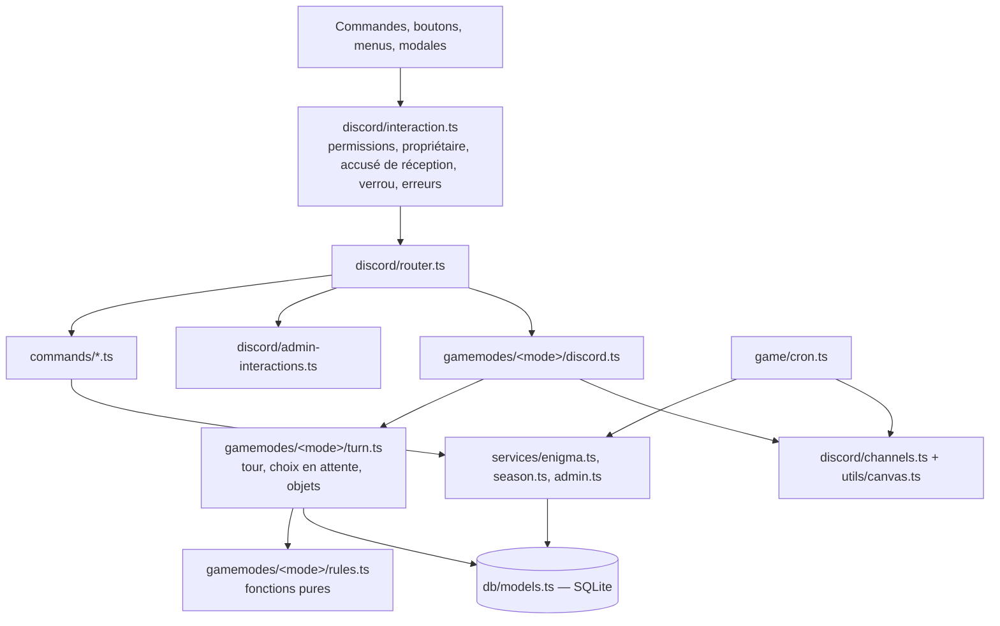

# Architecture d’Enigme Bot

Le bot héberge **une partie active** dans **un seul processus** Node.js (PM2, une instance). Tout le code applicatif est en TypeScript strict (`src/**/*.ts`) ; seuls les tests restent en JavaScript.

## Couches et responsabilités

| Couche | Fichiers | Rôle | Interdits |
|---|---|---|---|
| Frontière Discord | `discord/interaction.ts` | MJ uniquement pour `admin_*`, `reponse_*`, `modal_programmer_enigme` et la commande `/dev` ; propriétaire du composant ; accusé de réception avant tout traitement ; verrou global ; `GameRuleError` → message éphémère sans `[ERROR]` ; 10062/40060 → `[TIMEOUT]`. | Logique métier. |
| Routage / présentation | `discord/router.ts`, `commands/*.ts`, `gamemodes/*/discord.ts`, `discord/admin-interactions.ts` | Lire l'interaction, appeler un service, construire messages et composants, publier **après** validation SQL. | Écrire en base directement. |
| Services transactionnels | `gamemodes/*/turn.ts`, `services/*.ts`, `game/endgame.ts` | Relire l'état, valider (`GameRuleError`), écrire dans **une** transaction sous `withGameLock`. | Appeler Discord. |
| Règles pures | `gamemodes/mario_party/rules.ts`, `ile_defis/turn.ts#walk`, `landing.ts`, `shop.ts` | Dés, marche case par case, effets, boutique. Aléatoire injecté (`Random`). | Accès réseau. |
| Persistance | `db/models.ts`, `db/migrations.ts` | Modèles Sequelize, migrations versionnées. | `sync({ alter })`. |

## Choix en attente (`action_en_attente`)

Quand un déplacement s'arrête sur une décision (Étoile, Boutique, Boo, intersection, Portail, Cascade, Liane, Dragon), le service enregistre `{ type, case, token }` sur le joueur dans la même transaction.

- Toute résolution exige un choix du **même type sur la même case** : un vieux bouton ou menu (Boo, boutique, étoile, Dragon…) est refusé avec `STALE`.
- L'expiration (60 s, `discord/pending-timers.ts`) n'agit que si le `token` est inchangé.
- Après un redémarrage, `rearmTimers` réarme les expirations et `/jouer` réaffiche le choix (`renderPending`).
- Les objets s'utilisent par emplacement (`use_<CLÉ>_<index>`) : l'emplacement doit encore contenir cet objet.

## Concurrence

Le plateau est partagé : `withGameLock` autorise **une seule opération de jeu à la fois** dans le processus (joueurs, crons, MJ). Les interactions échouent immédiatement si le verrou est pris (`GameBusyError`) ; crons et timers attendent (`withScheduledLock`, qui détache le contexte de l'opération créatrice). L'imbrication dans une même opération est reconnue par `AsyncLocalStorage`. Une opération de plus de 50 s est signalée (`[WARN]`) mais jamais déverrouillée tant qu'elle peut écrire. Cette protection ne couvre pas plusieurs processus.

## Contrat des modes (`gamemodes/mode-interface.ts`)

Un mode est un dossier `gamemodes/<id>/` avec `mode.ts`, `maps/<map>/board.ts` + `plateau.png`, `variants/<variante>.ts`. Le registre valide au démarrage :

- métadonnées (`name`, `emoji`, `description`, `maxTours`, `hasStars`, `hasShop`, `hasBoo`, `isLinear`) ;
- `getInteractions()` → `{ handle, renderPending, rearmTimers }` ;
- `getEndgame()` → `{ close (dans la transaction de fin de saison), announce (après validation) }` ;
- `getItems`, `getBoardCases`, `getBoardImagePath`, `getVariantConfig`, `getInitialPlayerData` ;
- graphes de cases sans arête pendante et images présentes.

Une map ou variante inconnue lève une erreur (pas de repli silencieux). `test/contracts.test.js` vérifie chaque mode.

## Horloge de jeu (`utils/clock.ts`)

Les règles qui dépendent de l'heure ou du jour (samedi sans dé, Marché Noir, tranches de récompense, délai de `/deviner`, transition de 17h) lisent `gameNow()`, ou un `now` injecté dans les tests. Elles n'appellent jamais `new Date()` directement. Sur le bot de dev (`DEV_MODE=1`), `/dev horloge` applique un décalage en mémoire à cette horloge, et `/dev etape` appelle les handlers des crons à la demande (voir `docs/SETUP_DEV.md` §5). En production, le décalage est toujours nul et `/dev` n'existe pas.

## Crons (`game/cron.ts`, Europe/Paris)

| Heure | Service | Annonce |
|---|---|---|
| 15h lun-ven / 8h sam | rappel MP (`auto_remind_turn`) | — |
| 17h lun-ven | `season.dailyTransition` : énigme programmée → plateau verrouillé ; sinon tour sans énigme ; tour 30 ou victoire au Dragon → `endSeason` | fantômes, énigme, oublis |
| 18h/19h/20h | `publishHint` (marqué après envoi réussi) | indice |
| 21h lun-ven | `finishEnigma` puis annonce | réponse et gagnants |
| 10h sam / 21h sam | `openBets` / `settleBets` (état `plateau.mode_data.paris_ouverts`, survit aux redémarrages) | course de Yoshis |
| 11h dim | `openBlackMarket` | Marché Noir |
| minuit | purge des snapshots de plus de 7 jours | — |

## Démarrage

`npm start` compile (`scripts/build.cjs` : `tsc` + copie des images) puis lance `dist/src/index.js` : migrations → connexion Discord → création du plateau si absent → crons → heartbeat Kuma → reprise (clôture d'énigme en retard, indices manqués, réarmement des choix en attente).

## Rendu Canvas

`utils/canvas.ts` lit les cases depuis le registre (plateau actif). Fonds en cache mémoire (vidé par `invalidateBoardCache` à chaque nouvelle saison) ; avatars en cache borné (200 entrées, 5 min) avec délai réseau de 3 s ; un avatar indisponible est remplacé par des initiales (journalisé en `[WARN]`). Le dessin reste sur l'event loop ; l'encodage, natif et asynchrone, produit un JPEG qualité 90 (`BOARD_IMAGE_EXTENSION`) : environ 10 ms et 450 Ko, contre 200 ms et 2,2 Mo en PNG pour un plateau de 12 joueurs, sans différence visible.

## Limites connues

- Un seul processus et une seule partie : pas de table Saison ni de clé de serveur.
- Les rappels MP de `/deviner` sont en mémoire (perdus au redémarrage, sans effet sur le jeu).
- Les flux Discord sont testés avec de faux objets Discord (`test/discord_flow.test.js`) ; un test manuel sur un serveur de test reste nécessaire avant livraison.

Voir aussi : [DATABASE.md](DATABASE.md), [OPERATIONS.md](OPERATIONS.md), [TESTING.md](TESTING.md), [EDGE_CASES.md](EDGE_CASES.md), [GAMEPLAY.md](GAMEPLAY.md).
