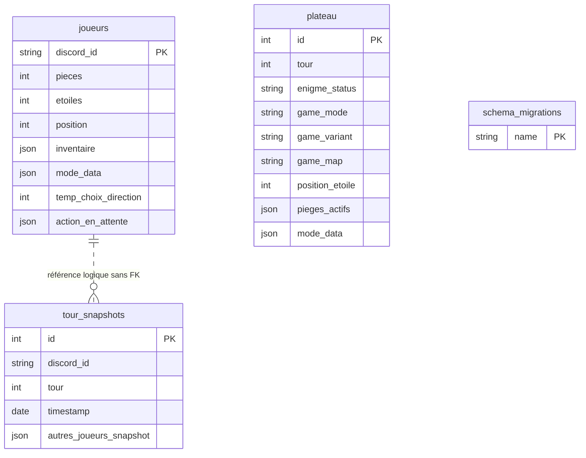

# Schéma de données

Source : `src/db/models.ts`. Évolution : `src/db/migrations.ts` et baseline figée `schema-v1.json`.

Le plateau `id = 1` est une convention applicative, pas une contrainte SQL empêchant un second plateau. Il n’existe pas de table Saison, ni de clé de serveur Discord : une seule partie active est gérée par cette installation. Les snapshots ne sont pas reliés par une clé étrangère et ne forment pas un journal complet de transactions. L’index `snapshot_player_time` couvre `discord_id, timestamp`.

## Dictionnaire des colonnes

Les valeurs par défaut ci-dessous sont celles des modèles/baseline actuels. L’adoption d’une ancienne base ne réécrit pas ses lignes ni ses valeurs SQL par défaut historiques. Les colonnes sans `allowNull: false` peuvent être nulles au niveau SQL ; le typage TypeScript ne constitue pas une contrainte SQL.

### `joueurs`

| Colonne | Type | Défaut / contrainte |
|---|---|---|
| `discord_id` | STRING | PK |
| `etoiles` | INTEGER | défaut `0` |
| `pieces` | INTEGER | défaut `0` |
| `position` | INTEGER | défaut `1` |
| `inventaire` | JSON | défaut `[]` |
| `guess_du_jour` | INTEGER | défaut `0` |
| `a_le_droit_de_jouer` | BOOLEAN | défaut `false` |
| `bonus_prochain_lancer` | INTEGER | défaut `0` |
| `de_limite` | BOOLEAN | défaut `false` |
| `type_de` | STRING | défaut `"normal"` |
| `de_pipe_valeur` | INTEGER | défaut `0` |
| `auto_remind_guess` | BOOLEAN | défaut `false` |
| `auto_remind_turn` | BOOLEAN | défaut `false` |
| `boutique_du_jour` | JSON | défaut `[]` |
| `jours_inactifs` | INTEGER | défaut `0` |
| `est_fantome` | BOOLEAN | défaut `false` |
| `fantome_unblock_used` | BOOLEAN | défaut `false` |
| `a_joue_ce_tour` | BOOLEAN | défaut `false` |
| `cases_restantes` | INTEGER | défaut `0` |
| `last_deviner_time` | DATE | — |
| `pari_coureurId` | INTEGER | défaut `null` |
| `pari_montant` | INTEGER | défaut `0` |
| `a_trouve_enigme` | BOOLEAN | défaut `false` |
| `stat_cases_chance` | INTEGER | défaut `0` |
| `stat_cases_malchance` | INTEGER | défaut `0` |
| `stat_cases_avancees` | INTEGER | défaut `0` |
| `stat_enigmes_trouvees` | INTEGER | défaut `0` |
| `stat_objets_utilises` | INTEGER | défaut `0` |
| `mode_data` | JSON | défaut `{}` |
| `temp_choix_direction` | INTEGER | nullable, défaut `null`, migration 002 |
| `action_en_attente` | JSON | nullable, défaut `null`, migration 003 |

### `plateau`

| Colonne | Type | Défaut / contrainte |
|---|---|---|
| `id` | INTEGER | PK, auto-incrément |
| `position_etoile` | INTEGER | défaut `1` |
| `pieges_actifs` | JSON | défaut `[]` |
| `tour` | INTEGER | défaut `0` |
| `enigme_resolue` | BOOLEAN | défaut `false` |
| `enigme_status` | STRING | défaut `"season_ended"` |
| `enigme_reponse` | STRING | — |
| `enigme_text` | TEXT | — |
| `enigme_indice1` | STRING | — |
| `enigme_indice2` | STRING | — |
| `enigme_indice3` | STRING | — |
| `enigme_publiee` | BOOLEAN | défaut `false` |
| `indice1_publie` | BOOLEAN | défaut `false` |
| `indice2_publie` | BOOLEAN | défaut `false` |
| `indice3_publie` | BOOLEAN | défaut `false` |
| `enigme_gagnants` | JSON | défaut `[]` |
| `enigme_channel_id` | STRING | — |
| `fin_enigme_timestamp` | BIGINT | — |
| `blocs_caches` | JSON | défaut `{}` |
| `game_mode` | STRING | défaut `"mario_party"` |
| `game_variant` | STRING | défaut `"standard"` |
| `game_map` | STRING | défaut `"night_sky"` |
| `mode_data` | JSON | défaut `{}` |

### `tour_snapshots`

| Colonne | Type | Défaut / contrainte |
|---|---|---|
| `id` | INTEGER | PK, auto-incrément |
| `discord_id` | STRING | NOT NULL |
| `tour` | INTEGER | NOT NULL |
| `timestamp` | DATE | date courante à la création du modèle |
| `position` | INTEGER | — |
| `pieces` | INTEGER | — |
| `etoiles` | INTEGER | — |
| `inventaire` | JSON | — |
| `a_le_droit_de_jouer` | BOOLEAN | — |
| `a_joue_ce_tour` | BOOLEAN | — |
| `cases_restantes` | INTEGER | — |
| `jours_inactifs` | INTEGER | — |
| `est_fantome` | BOOLEAN | — |
| `fantome_unblock_used` | BOOLEAN | — |
| `bonus_prochain_lancer` | INTEGER | — |
| `de_limite` | BOOLEAN | — |
| `type_de` | STRING | — |
| `de_pipe_valeur` | INTEGER | — |
| `plateau_position_etoile` | INTEGER | — |
| `plateau_pieges_actifs` | JSON | — |
| `plateau_blocs_caches` | JSON | — |
| `autres_joueurs_snapshot` | JSON | — |
| `temp_choix_direction` | INTEGER | nullable, défaut `null`, migration 002 |

## Formats JSON et invariants

- `inventaire` : tableau de **noms affichés** d’objets, ex. `["🍄 Champignon"]`. Les achats limitent à trois objets ; cette limite n’est pas un CHECK SQL.
- `boutique_du_jour` : tableau d’identifiants du catalogue, ex. `["champignon", "cle"]`.
- `pieges_actifs` : objets `{ position, type, poseur }`, où `type` vaut `pieces` ou `etoile` et `poseur` est un identifiant Discord.
- `blocs_caches` : positions par récompense (`etoile`, `pieces_20`, `pieces_10`, `pieces_5`), `-1` indique une récompense consommée.
- `enigme_gagnants` : entrées contenant `discord_id`, `tranche` et, pour Mario Party, `pieces`.
- `action_en_attente` : choix bloquant le déplacement, `{ type, case, token }` et, pour un Portail, `target` (case du portail). Types Mario Party : `etoile`, `boutique`, `boo`, `intersection` ; île : `intersection`, `portail`, `cascade`, `liane`, `dragon`. `null` hors attente. Une résolution exige le même `type` sur la même `case` ; une expiration exige le même `token`.
- `joueurs.mode_data` : Mario Party `{}` ; île `{ bonus_de: 'none' | 'gold' | 'silver' | 'bronze' | 'chocolat', double_lancer: boolean }` (`double_lancer` est recalculé à chaque lancer).
- `plateau.mode_data` : Mario Party `{ paris_ouverts?: boolean }` (paris du samedi) ; île `{ portails_ouverts: number[], cascade_desactivee: boolean, gagnants_dragon: string[] }`. Remis à `{}` par `/admin start`. Lu via `boardData()` côté île, qui ignore les valeurs mal typées.
- `autres_joueurs_snapshot` : copies partielles des autres joueurs (`discord_id`, pièces, étoiles, inventaire, position). Les statistiques et l’intégralité de `mode_data` ne sont pas restaurées par ce mécanisme historique.

Réassigner les tableaux/objets JSON lors des modifications ou signaler explicitement `.changed(champ, true)`. Un type compilé ne valide pas automatiquement le JSON déjà stocké. Muter un objet puis le réassigner à lui-même ne suffit pas : Sequelize compare les références (cause historique des portails et victoires au Dragon jamais sauvegardés, voir DB-04).

`enigme_status` utilise `season_ended`, `programmee`, `active`, `finished`. `tour = 0` attend le lancement. Le champ accepte actuellement une chaîne SQL quelconque ; les transitions doivent donc être validées dans le domaine.

## Migrations

- `001-baseline` : crée une base vide ou adopte une base contenant les colonnes attendues, sans effacer de données.
- `002-persist-direction` : ajoute la direction persistante aux joueurs et snapshots, puis l’index des snapshots.
- `003-pending-action` : ajoute `joueurs.action_en_attente` (choix en attente persistant).
- `schema_migrations` : mémorise les migrations validées dans la même transaction que les opérations de schéma. Une version de schéma inconnue est refusée.

Avant une évolution, tester une base neuve **et** une copie du schéma précédent. Voir [OPERATIONS.md](OPERATIONS.md).
